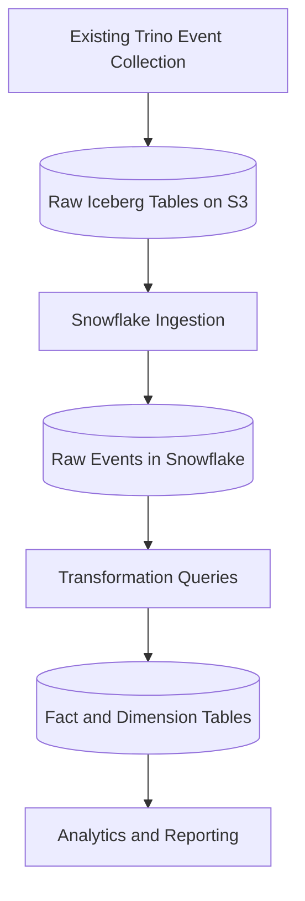

# Meta DWH — Architecture Overview

## 1. Overview

The goal of the Meta Data Warehouse (DWH) is to analyze how users and teams use the data stored in our Trino cluster. By collecting query usage statistics and maintaining historical records, we want to understand how usage patterns and resource consumption change over time.

The warehouse should support questions such as:
- How many distinct users queried a particular table during a given period?
- How many queries did a particular team execute?
- How much CPU time and data processing did a team consume?
- Which tables are queried most frequently?
- How has usage changed over time?

## 2. Scope

The existing infrastructure already collects raw events from the Trino cluster and stores them in Amazon S3 as Apache Iceberg tables. This part of the system is outside the scope of this project.

Our focus is on making this data available in Snowflake, transforming the raw events into an analytical data model, and maintaining the resulting tables as new events arrive.

The main tasks are:
- Ingesting the existing raw event data into Snowflake.
- Designing the warehouse schema.
- Implementing SQL transformations to populate the analytical tables.
- Handling incremental updates and preserving historical usage data.
- Providing example queries that answer the required analytical questions.

## 3. Architecture

### Snowflake ingestion

The raw Apache Iceberg tables stored in Amazon S3 must be made available in Snowflake before they can be transformed into the analytical model.

This part of the pipeline is also within the scope of the project. We will describe and implement the necessary steps to access the source data in Snowflake and populate the corresponding raw tables, depending on the available Snowflake and Iceberg configuration.

The ingestion process should account for schema compatibility, incremental data availability, and duplicate records where relevant. The goal is to ensure that the raw events are available in a consistent form for downstream transformations.

### Transformations

SQL transformations process the raw events and populate the fact and dimension tables. They extract query metadata, associate queries with users and teams, identify accessed tables, and prepare the data for historical analysis.

The transformations should also handle duplicate events and support incremental processing as new data becomes available.

### Analytical model

The warehouse will use a star schema centered on query executions. The main fact table will store one record per query, including its user, team, execution time, and available resource usage metrics.

Time-related dimensions will support aggregations across different periods. A separate table will represent the relationship between queries and the tables they access, since a single query can reference multiple tables.

The detailed schema, table granularity, relationships, and transformation logic will be described separately.

## 4. Historical Data

A key requirement is to retain usage statistics over time rather than only track the latest state.

Each query execution should be associated with its execution timestamp and the available resource metrics. This allows us to compare usage across days, months, and other time periods.

## 5. Resource Usage Metrics

Resource consumption will be measured using the metrics available in the source events. Potential metrics include:

- **CPU time:** the amount of CPU time consumed by a query.
- **Execution duration:** the elapsed time between query execution start and completion.
- **Processed input bytes:** the amount of input data processed by a query.
- **Processed rows:** the number of rows processed, where available.

These metrics describe different aspects of workload usage and should be analyzed separately.

The final set of metrics depends on the information provided by the existing Trino events. Their definitions and aggregation rules will be specified as part of the data model and transformations.

## 6. Assumptions

The initial design relies on the following assumptions:

- Raw Trino events are already collected and stored in Iceberg tables on Amazon S3.
- The source data can be made available in Snowflake.
- Query executions can be uniquely identified, for example by a query ID.
- User identifiers are available in the query events.
- Team membership can be obtained from the source events or an additional metadata source.
- Accessed tables can be etracted from the sql query text.
- Resource usage metrics depend on the fields exposed by the existing Trino event collection.

Any missing metadata and the approach used to obtain it will be documented alongside the source data and transformation specifications.